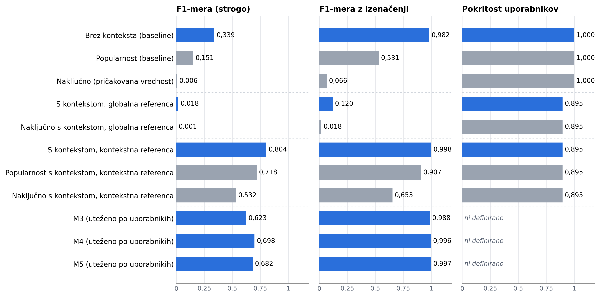
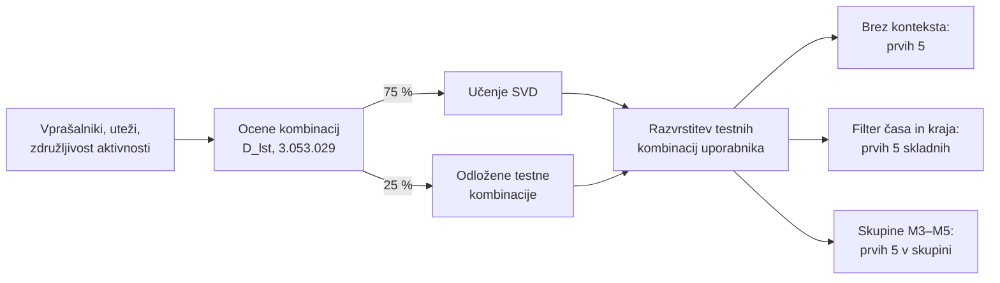
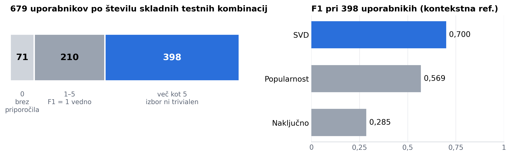

# Kontekstualiziran priporočilni sistem za dnevne aktivnosti starejših

*Master's thesis (University of Ljubljana, Faculty of Electrical Engineering) on recommending combinations of one to three daily activities to elderly users: an SVD matrix factorization model predicts ratings computed from questionnaire answers, and a post-filter keeps only combinations that fit a (simulated) time and place. Evaluation is done on held-out ratings against popularity and random ranking; the code is in Python (Surprise), the text in Slovene.*

Magistrsko delo, Fakulteta za elektrotehniko Univerze v Ljubljani · **Avtor:** Gašper Leskovec · **Mentor:** prof. dr. Andrej Košir

Sistem starejšim priporoča kombinacije ene do treh dnevnih aktivnosti: matrična faktorizacija (SVD) napove ocene, izračunane iz vprašalnikov, naknadni filter pa upošteva čas in kraj izvedbe. Prispevek je ločena obravnava napovedovanja ocen in konteksta ter vrednotenje na odloženih podatkih v primerjavi s popularnostjo in naključnim rangiranjem.

Magistrska naloga: [besedilo (LaTeX)](overleaf/2024_GLeskovec_MAG/main.tex), PDF bo objavljen po zagovoru · [Zagovor](presentation/Zagovor_Gasper_Leskovec.pptx) · [Koda](src/) · [Rezultati](outputs/heldout_evaluation/RUN_20261125_222631.md)



## Postopek



## Ključni rezultati

Zagon `20261125_222631`: 679 uporabnikov, 6.579 kombinacij. Na odloženem testnem delu SVD doseže RMSE 0,0819, MAE 0,0531 in FCP 0,9966. Natančnost in priklic sta pri vseh različicah enaka F1.

| Različica | F1 SVD (z izenačenji) | Popularnost | Naključno | Pokritost |
|---|---:|---:|---:|---:|
| Brez konteksta | 0,339 (0,982) | 0,151 | 0,006 | 1,000 |
| S kontekstom, globalna referenca | 0,018 (0,120) | – | 0,001 | 0,895 |
| S kontekstom, kontekstna referenca, 608 uporabnikov | 0,804 (0,998) | 0,718 | 0,532 | 0,895 |
| … od tega 398 uporabnikov z več kot 5 skladnimi kombinacijami | 0,700 (0,996) | 0,569 | 0,285 | – |
| M3 / M4 / M5 (uteženo po uporabnikih) | 0,623 / 0,698 / 0,682 | – | – | – |



Pri 210 uporabnikih z eno do petimi skladnimi kombinacijami je F1 pri vsakem razvrščanju 1, zato je informativna primerjava na 398 uporabnikih z več kot petimi: tam SVD (0,700) razvršča bolje od popularnosti (0,569) in naključnega rangiranja (0,285).

Omejitve: ocene so izračunane po pravilu, zato rezultati merijo, kako dobro model povzame to pravilo, in ne zadovoljstva uporabnikov. Posamezen uporabnik ima največ šest različnih ocen, zato so izenačenja pogosta. Konteksti so simulirani; kontekstna referenca in M3–M5 niso neposredno primerljivi z globalno referenco.

## Struktura

```
src/            runGeneratorOfD_v7.py (eksperiment), elderly_recsys_tools.py (funkcije)
tests/          test_tools.py
data/           vhodni podatki; D_lst_summary/ opisuje nabor ocen D_lst
outputs/        heldout_evaluation/ (zagoni, RUN_*.md, izvozi, tabele in slike za LaTeX)
overleaf/       besedilo naloge (main.tex, slike, tabele)
presentation/   zagovor in make_slide_figures.py (slike slajdov in slika 3.1 naloge)
```

## Hitro preverjanje (brez podatkov)

```bash
git clone https://github.com/leskovecg/masters-thesis-recommender-system.git
cd masters-thesis-recommender-system
python3.11 -m venv .venv
.venv/bin/python -m pip install -r requirements.txt
.venv/bin/python -m unittest discover -s tests
```

## Polni zagon (zasebni raziskovalni podatki)

Potrebni so vhodni podatki v `data/` in nabor ocen `D_lst` (582 MB, ni v gitu). Preverjeno 2026-11-25 (WSL2 Ubuntu, Python 3.11.18), zagon traja približno 5 minut.

```bash
mkdir -p data/D_lst          # sem kopiraj D_lst_full_20260202_150312.pkl
MPLBACKEND=Agg PYTHONUTF8=1 .venv/bin/python src/runGeneratorOfD_v7.py
```

Izvozi dobijo časovni žig zagona in se shranijo v `outputs/heldout_evaluation/`. Privzeto (`SKIP_TUNING = True`) se primerjava algoritmov in iskanje nastavitev preskočita; s `SKIP_TUNING = False` trajata več ur ([RUN_20261015_150006.md](outputs/heldout_evaluation/RUN_20261015_150006.md)). `USE_EXISTING_D_LST = False` nabor `D_lst` ponovno ustvari iz vhodov (približno 30 minut).

D_lst se iz vhodov ponovi bitno enako (SHA-256 9b8ae198…), preverjeno 2026-11-26.
Po commitu `cb3edc0` je bila koda preurejena; SHA-256 ponovno ustvarjenega `D_lst` in vsi izvozi zagona `20261125_222631` so bili preverjeni kot enaki.

**Podatki niso namenjeni javni objavi** (vprašalniki o zdravju, uteži uporabnikov, `D_lst`). Za dostop se obrni na avtorja ali mentorja. Izvorno raziskavo je izvedel Inštitut Antona Trstenjaka za gerontologijo in medgeneracijsko sožitje.

## Testi

`python -m unittest discover -s tests` (33 testov; sintetični podatki, `D_lst` ni potreben). Podrobnosti posameznih zagonov, okolje in hashi so v `outputs/heldout_evaluation/RUN_*.md`.
